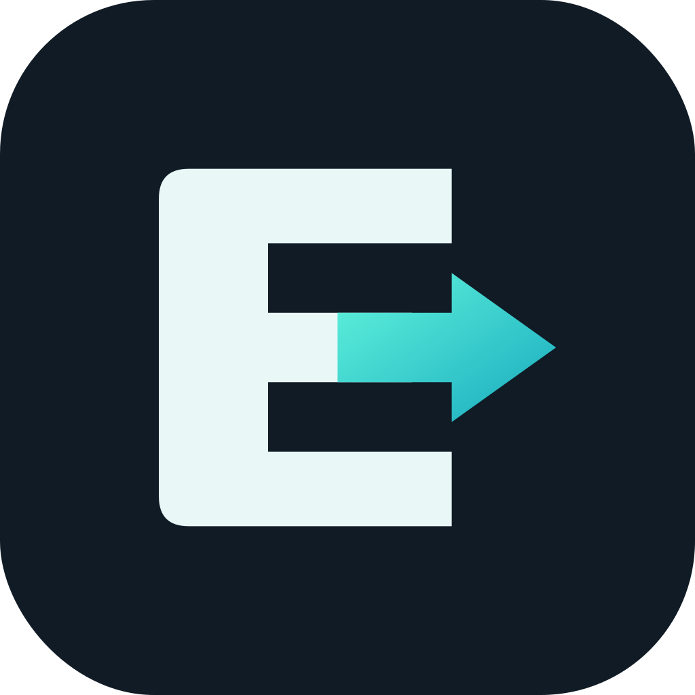
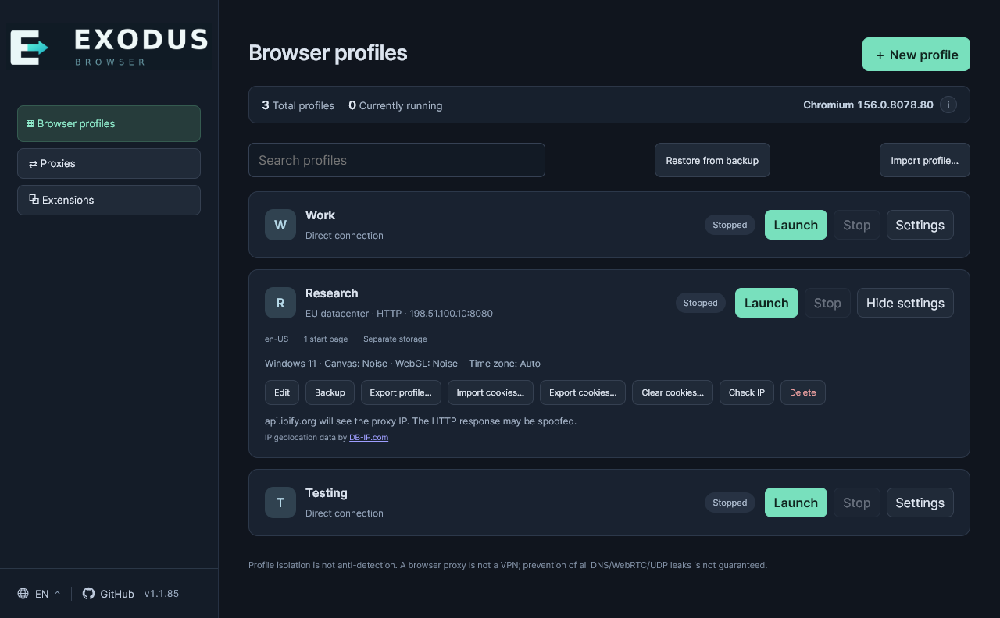

<p align="center">
  
</p>

<h1 align="center">Exodus Anti-Detect Browser</h1>

<p align="center">
  <strong>Anti-detect tools. Separate profiles. Local control.</strong><br>
  A local-first anti-detect browser for Windows with isolated profiles, configurable fingerprints and per-profile proxies.
</p>

<p align="center">
  <a href="https://github.com/thejohnd0e/exodus-browser/releases/latest"></a>
  
  
  
  <a href="LICENSE"></a>
</p>

<p align="center">
  <a href="https://github.com/thejohnd0e/exodus-browser/releases/latest"><strong>Download for Windows</strong></a>
  &nbsp; · &nbsp; <a href="#get-started">Get started</a>
  &nbsp; · &nbsp; <a href="#features">Features</a>
  &nbsp; · &nbsp; <a href="#anti-detect-and-privacy">Anti-detect &amp; privacy</a>
  &nbsp; · &nbsp; <a href="https://github.com/thejohnd0e/exodus-browser/issues">Help &amp; feedback</a>
</p>

---

**Exodus Browser** combines isolated Chromium profiles with anti-detect controls for the browser information websites can inspect. Keep work, personal sessions and testing environments apart, choose a fingerprint and optional proxy for each profile, and control which cookies and website data each context retains.

Profiles stay on your computer. There is no Exodus account to create, no subscription and no cloud synchronization. Your everyday Chrome profile is not used.

<p align="center">
  
</p>

<p align="center"><sub>Example profiles. Each one has separate website data, its own proxy selection and its own fingerprint settings.</sub></p>

## Features

| Feature | What you can do |
|---|---|
| **Separate profiles** | Create, name, search and organize profiles with notes. Cookies and website data stay separate and persist between launches. |
| **Parallel browsing** | Run several profiles at once, each in its own Chromium browser process. Launch and stop them from one place. |
| **Per-profile proxies** | Save named HTTP, HTTPS or SOCKS5 connections and assign them to profiles. Reuse one saved connection across multiple profiles. |
| **IP checks** | Check a saved proxy's external IP on demand and see an estimated country flag beside the result. |
| **Anti-detect controls** | Generate a fingerprint preset or adjust browser identity, graphics/audio-related signals, time zone, location, screen, hardware and WebRTC settings. |
| **Extensions** | Add an extension from a Chrome Web Store link, a folder or a ZIP archive. Choose which profiles use it and update it explicitly. |
| **Cookies** | Import and export JSON or Netscape cookie files. Clear a profile's cookies without clearing its other website data. |
| **Saved tabs** | Choose start pages or enable restoring tabs from the previous session for an individual profile. |
| **Backups and transfers** | Back up a stopped profile, restore it as a new profile, or use portable export/import to transfer supported profile data. |
| **Two interface languages** | Switch the manager between English and Russian. Set a separate website language for each profile. |

## Anti-detect and privacy

### Control your browser fingerprint

Websites can recognize a browser using more than cookies: its reported platform, screen, graphics, audio behavior and other characteristics can form a **browser fingerprint**. Exodus lets you adjust selected parts of that fingerprint separately for each profile.

| Control | What it changes |
|---|---|
| **Browser identity** | The reported operating system and User-Agent, plus the profile's website language. |
| **Graphics and audio signals** | Canvas and WebGL can use real output, profile-specific noise or disabled modes. ClientRects and Audio offer noise settings; WebGL vendor/renderer can be set manually and WebGPU can be turned off. |
| **Screen and hardware** | Reported screen dimensions, CPU core count and memory size. These settings do not replace your physical hardware. |
| **Time zone and location** | Choose a manual time zone and location instead of the system/browser defaults. These are not automatically matched to the proxy IP. |
| **WebRTC** | Keep normal behavior, restrict non-proxied UDP, alter some locally reported addresses or disable WebRTC. Altered mode does not substitute the proxy's public IP. Restrictive modes can affect calls and other websites; they are not a guarantee against every IP leak. |

**New fingerprint** generates a preset for your configured Chromium version; you can then review and adjust it. Fingerprint changes are a choice, not an invisible always-on shield: a new profile starts with many real browser values until you configure them or generate a preset.

Noise modifies selected outputs; it does not recreate a different physical device or hide every fingerprint signal.

### Reduce tracking between browsing contexts

- **Separate website storage.** Cookies and other saved website data are not shared between profiles. A tracking identifier saved in one profile's storage is not automatically available in another profile.
- **Choose the connection per profile.** An assigned proxy changes the browsing connection's exit address. Without a proxy, the profile uses your normal connection; reusing an IP address can still link activity.
- **Control persistent cookies.** Import only cookies you trust, export them when needed, or clear them for a stopped profile. Cookies intentionally persist between launches; closing a profile does not erase its history or identifiers. Clearing cookies also leaves other website storage intact.
- **Keep management local.** Profile data stays on your computer rather than being synchronized to an Exodus cloud account. Websites, proxies and installed extensions can still observe information you send to them.

**There is no built-in ad blocker or tracker-blocking list.** You can add a compatible content-blocking extension to selected profiles. Only install extensions you trust: their permissions may let them read or change browsing data.

### Know the boundaries

Anti-detect controls help you manage selected identifying signals; **they do not make you invisible, guarantee anonymity or guarantee that profiles cannot be linked**. Script-based fingerprint changes can themselves be detected, and Exodus does not disguise every network-level identifier. Signing into the same account, importing the same cookies or reusing identifying information can connect profiles regardless of their settings.

Use separate profiles for separate contexts, review fingerprint and proxy settings before browsing, and keep your Chromium engine and trusted extensions current. A proxy is not a system VPN, and choosing a location or time zone does not by itself conceal your real network address. See [Privacy and limitations](#privacy-and-limitations) for the remaining caveats.

## Get started

### 1. Install Exodus Browser

Open the **[latest release](https://github.com/thejohnd0e/exodus-browser/releases/latest)** and download the `ExodusBrowser-Setup-<version>.exe` installer under **Assets**. Run it and follow the setup wizard.

- **Supported:** Windows 10 or Windows 11, 64-bit (x64).
- **Not required:** Node.js, npm or other developer tools when using the installer.
- **Internet access:** needed for downloads and online browsing; managing existing profiles does not require an Exodus account or cloud connection.

> The installer is not digitally signed yet, so Windows SmartScreen may display a warning. Only use releases from this repository; do not disable Windows security protections.

### 2. Set up Chromium once

In Exodus, click **Download Chromium** to install the browser used by your profiles. Alternatively, choose **Link Chromium…** and select `chrome.exe` from an existing Chromium installation you trust.

This browser runs separately from your personal browser. You can create profiles before setting it up, but launching them requires an available engine.

### 3. Create your first profile

Click **New profile**, enter a name, and choose a website language and start pages. Add a proxy if needed, then save the profile and click **Launch**.

### 4. Make it your own

Expand a profile's **Settings**, then choose **Edit** to change its fingerprint, enable session restoration or select extensions. Cookie and backup actions are in the expanded card. Stop the profile before changing settings or making a backup.

## Everyday use

### Proxies

Add connections in **Proxies**, then select a saved connection in each profile's settings. HTTP and HTTPS proxies support usernames and passwords; SOCKS5 connections currently work without authentication. Select **No proxy** for a direct connection.

- Changes to a saved proxy take effect the next time an assigned profile starts.
- **Check IP** checks the saved connection. Restart a running profile after changing its proxy before comparing its route with that result.
- A failed configured proxy does not silently switch the profile to a direct connection.
- PAC files, proxy chains and authenticated SOCKS5 are not supported.

### Fingerprint and profile preferences

Use **New fingerprint** to generate a preset for your linked browser version, or adjust the settings yourself. Available controls include the operating system and User-Agent, Canvas, WebGL, WebGPU, ClientRects, Audio, WebRTC, screen size, CPU and memory, time zone, and manual location.

The default time zone follows your system; it is **not** automatically detected from the proxy IP. Use **Manual** to choose a time zone. Extensions that also change the time zone can conflict with these settings.

Enable **Restore tabs from the previous session** when you want a profile to reopen its saved pages instead of its start pages. This restores tab addresses, not unsaved forms or a complete snapshot of a page.

### Extensions and cookies

Add extensions once in **Extensions**, then enable the ones you need in each profile. Extensions must use the current **Manifest V3** format. Library changes apply on the next profile launch. Some extensions may behave differently from a normal store installation.

Cookie actions are available in a stopped profile's **Settings**:

- **Import cookies…** reads JSON or Netscape files, adding cookies and replacing matching entries.
- **Export cookies…** saves either format.
- **Clear cookies…** removes all cookies while keeping other local website data. Cookie-based sessions usually require signing in again; other saved sign-in methods may remain.

Cookie files are limited to 5 MiB and 20,000 entries. Partitioned cookies are not supported by import/export. Treat exported cookie files like passwords.

### Backups and moving profiles

Use **Backup** for a stopped profile and **Restore from backup** to create a new profile from an archive. Restoration does not overwrite the original profile.

Use **Export profile…** and **Import profile…** for portable transfers of profile settings, supported website data, cookies and saved tab addresses. Windows-bound saved passwords and other operating-system-protected data are not portable. Ordinary backup cookies may also remain tied to the original Windows account.

Portable import/export requires Chromium to be set up in Exodus. Archives do not include the extension library or a profile's extension selections: add and select your extensions again after restoration or transfer.

**Proxy passwords are not included in either kind of archive** and must be entered again after import or restoration. Archives can contain readable cookies and other private data: keep them somewhere safe and share them only with people you trust.

## Updates

Click the **version number at the bottom of the sidebar** to check for a newer release. Choose **Download update**, wait for the file to be downloaded and verified, then stop all profile browsers and click **Install and restart**. Complete the Windows installation wizard.

There are **no background update checks or silent installations**. You can also install a newer release manually after closing Exodus and its profile browsers.

Updating Exodus does not automatically replace a previously installed Chromium engine. If the built-in updater cannot complete, download the current installer from [Releases](https://github.com/thejohnd0e/exodus-browser/releases/latest) using your normal browser.

## Your data

Profiles, saved connections, settings, extensions and the managed browser are stored locally under:

```text
%APPDATA%\Local Profiles
```

The folder keeps its original name for compatibility. Installing or updating Exodus does not move it, and uninstalling the application leaves it intact. Back up important profiles before moving computers or making major changes.

Saved proxy passwords are encrypted using Windows protection. **This does not mean that all profile data, backups or cookie exports are encrypted.** Profiles and exports can contain active logins and other sensitive information.

## Privacy and limitations

- **Isolation is not a promise of anonymity or undetectability.** Fingerprint adjustments do not guarantee that websites cannot recognize or link profiles.
- **A profile proxy is not a system VPN.** It does not cover every application or guarantee prevention of all DNS, WebRTC or other network leaks.
- **Local-first does not mean no network traffic.** Websites, proxy IP checks, downloads and manually requested updates contact their respective services.
- **IP and country results are advisory.** The IP check uses an unencrypted HTTP service, so the response can be altered in transit; the country is an estimate.
- **No cloud or team workspace.** There is no account synchronization or shared online profile storage.
- **Windows only.** Other operating-system choices in the fingerprint editor do not make Exodus a macOS, Linux or mobile application.

## Help and feedback

- **Browser not installed?** Use **Download Chromium** or **Link Chromium…** before launching a profile.
- **Profile blocked after a crash?** Close the remaining profile browser manually, then restart Exodus. The manager does not forcibly kill unrelated processes.
- **Chrome for Testing banner?** That banner is normal for the managed browser; it is not an installation error.
- **Found a problem or have a suggestion?** [Open an issue](https://github.com/thejohnd0e/exodus-browser/issues). Include your Exodus version, Windows version, steps to reproduce and a screenshot if useful. Remove passwords, cookie contents and other private information first.

## License

Exodus Browser is **free software** under the **GNU General Public License, version 3 only** (GPL-3.0-only), and is provided **without warranty**.

- You may use it for any purpose, study it, modify it and share it, including commercially.
- If you distribute the program or a modified version, you must make the corresponding source code available under the same license.
- The full text is in [LICENSE](LICENSE); third-party components and attribution are listed in [NOTICE](NOTICE).

The names **Exodus Browser** and **Exodus Anti-Detect Browser**, the logo and the artwork in `ico/` are **not licensed for reuse**. Modified or differently published distributions must use their own name and branding.

The managed Chromium build is downloaded separately at your request and keeps its own licenses; it is not part of this repository or the installer.

## For developers

Looking to build, test or understand the internals? See the [development guide](docs/development.md), [architecture](docs/architecture.md) and [verification notes](docs/verification.md). Developer setup is separate from the Windows installer instructions above.
